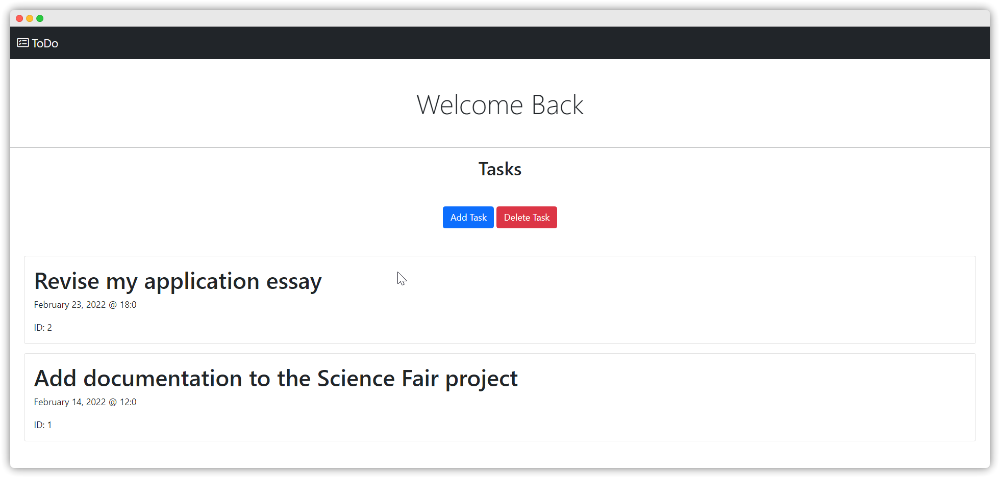

# ToDo

[](https://github.com/MrFellox/todo-web)


A simple webpage that helps you to keep track of your tasks.<br>
_2nd finalist in the Episcopal Science and Technology Fair 2022._



## Features

<li>Responsive design</li>
<li>Runs on your local network. So you can access this page on any device that is connected to your network.</li>
<li>Simple, miniaturized, and minimalistic</li>

## Getting Started

### Running with Docker Compose

To run the app using Docker Compose, you need to have [Docker](https://www.docker.com/get-started) installed on your machine.

1. **Clone the repository** or download the source code from GitHub.

2. **Create a `.env` file** in the root directory with the following format:

```env
# Application Configuration
SECRET=your-secret-key-here

# Database Configuration (for Docker Compose use these values)
POSTGRES_HOST=db
POSTGRES_PORT=5432
POSTGRES_DB=todo_db
POSTGRES_USER=todo_user
POSTGRES_PASSWORD=your-password-here
```

3. **Create a `.db.env` file** in the root directory with the following format:

```env
# PostgreSQL Database Configuration
POSTGRES_DB=todo_db
POSTGRES_USER=todo_user
POSTGRES_PASSWORD=your-password-here
```

> [!NOTE]
> Make sure the database credentials in `.env` and `.db.env` match. The `POSTGRES_HOST` should be set to `db` (the service name in docker-compose.yaml) and `POSTGRES_PORT` to `5432`.

4. **Run Docker Compose**:

```shell
$ docker compose up -d
```

The application will be available at `http://localhost:8000`.

### Building the Docker Image

If you want to build the Docker image manually:

1. **Create a `.env` file** as described above.
2. **Build the image**:

```shell
$ docker build -t todo-web .
```

3. **Run the container** (make sure you have a PostgreSQL database running):

```shell
$ docker run -p 5000:5000 --env-file .env todo-web
```

> [!NOTE]
> When running the container manually, ensure `POSTGRES_HOST` points to an accessible PostgreSQL instance (not `db` unless using Docker networks).

### Running from Source

Before starting, make sure you have installed [Python](https://python.org/download) 3.11 or above, and PostgreSQL.

1. [Download](https://github.com/MrFellox/todo-web/archive/refs/heads/main.zip) the source code from GitHub, or clone this repository.

2. Install [uv](https://docs.astral.sh/uv/), an extremely fast Python package installer and resolver.

3. Install dependencies using uv:

```shell
$ uv sync
```

4. Create a `.env` file in the root directory with your configuration (see the `.env` format in the Docker Compose section above). Make sure `POSTGRES_HOST` and `POSTGRES_PORT` point to your PostgreSQL instance.

5. Run the application:

```shell
$ uv run gunicorn --bind 0.0.0.0:5000 start:app
```

The application will be available at `http://localhost:5000`.
